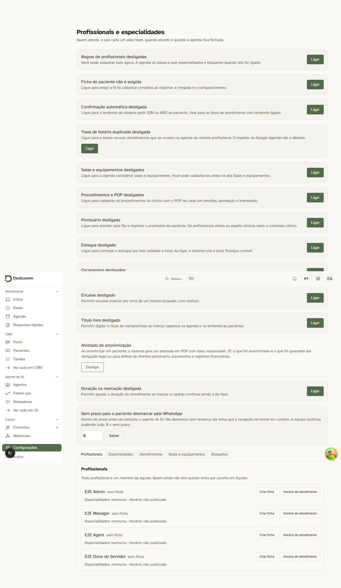
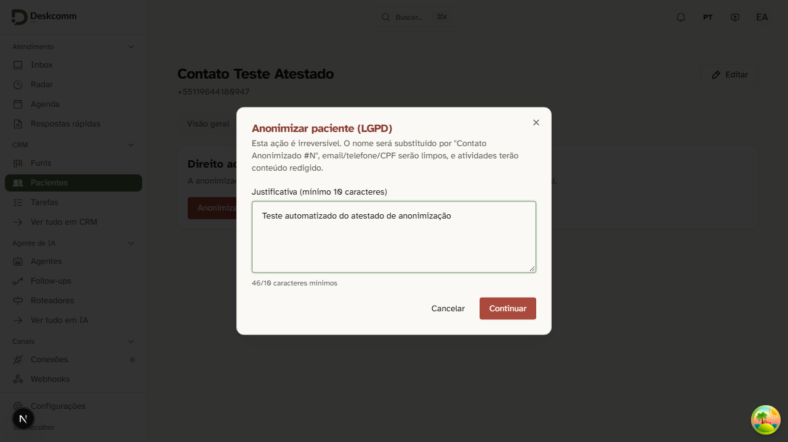
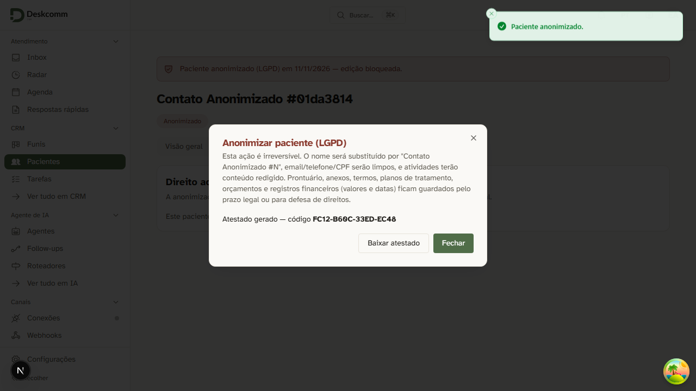
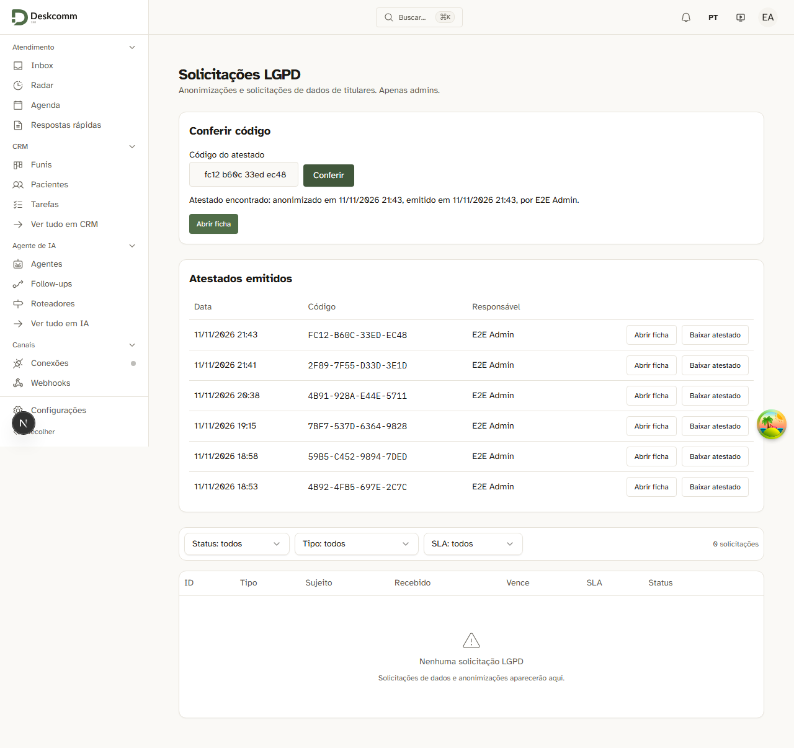
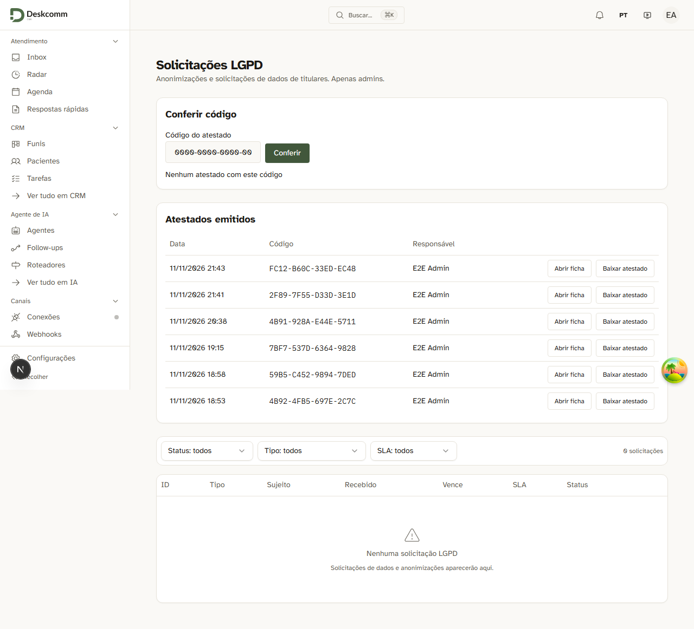
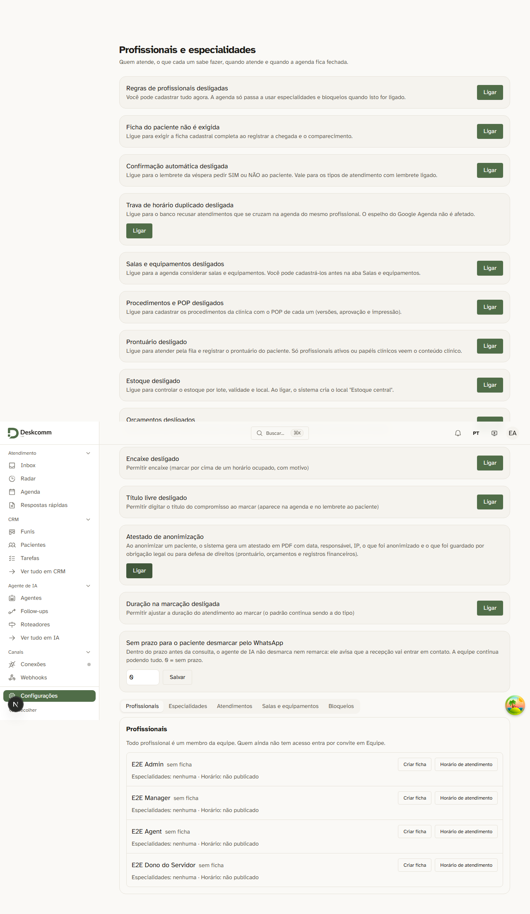
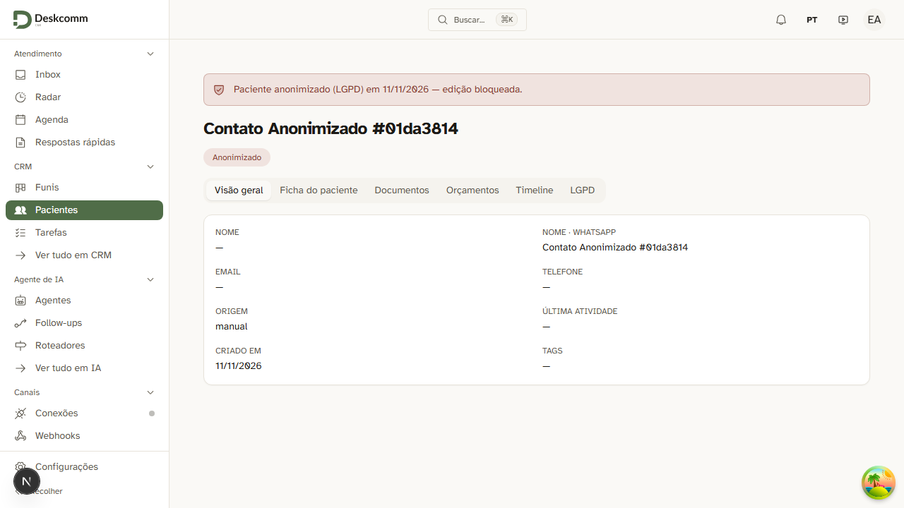

# #87 — Atestado de anonimização (LGPD) — handoff

Branch: `feature/lgpd-atestado-anonimizacao` · Épico #78 (lote 2) · Upstream #3321 (ideia adaptada, não é cherry-pick).
Spec: [design.md](design.md) · Plano: [plano.md](plano.md).

## O que mudou, em português simples
Quando um paciente pede para apagar os dados, a clínica usa o botão **Anonimizar** na ficha do contato. Antes, isso
acontecia sem deixar nenhum papel. Agora, **se a clínica ligar a chave nova**, cada anonimização gera um **atestado em
PDF**, no papel timbrado da clínica, que mostra:

- o número do protocolo, a data e a hora (com o fuso), quem clicou (nome, e-mail, papel) e de qual IP;
- **o que foi anonimizado** (dados de contato, ficha, conversas, agenda, tarefas etc.);
- **o que ficou guardado e por quê**, com a contagem por categoria: prontuário e atendimentos, fotos e anexos
  clínicos, documentos e termos, planos de tratamento, registros financeiros e orçamentos, cada um com a base legal;
- um **código de autenticidade** (curto, para conferir).

O PDF **não traz o nome, o documento nem o contato do paciente**: ele é identificado só pelo protocolo.

Onde aparece:
- **Pacientes › aba LGPD** (ficha do contato anonimizado): botão **Baixar atestado**; se o contato foi anonimizado sem
  atestado (chave desligada na hora ou falha), um admin com a chave ligada clica em **Gerar atestado**. O PDF avisa que
  foi emitido depois e mostra as duas datas. Cada contato tem no máximo um atestado.
- **Tela LGPD**: lista "Atestados emitidos" (com download) e a caixa **Conferir código**, que diz se o código existe
  nesta clínica e mostra data, autor e protocolo. A conferência é só dentro do sistema, para administrador.
- **Configurações › Profissionais**: o cartão com a chave. Ela **nasce desligada**; desligada, tudo funciona como antes.

## Como validar na 3001 (passo a passo)
A 3001 roda esta branch, no banco de teste local (clínica fictícia "E2E Test Org").

1. Abra `http://localhost:3001/login` e entre como `e2e-admin@deskcomm.test` (senha e código de duas etapas estão em
   `.e2e-creds.json`, na pasta `wt-atestado-87`).
2. Vá em **Configurações › Profissionais** e ache o cartão do atestado de anonimização. Clique em **Ligar**.
3. Crie ou escolha um contato **de teste** em **Pacientes**, abra a ficha e a aba **LGPD**. Clique em **Anonimizar**
   e confirme. O diálogo mostra o **código do atestado**.
4. Clique em **Baixar atestado** e abra o PDF. Confira: protocolo, data, autor, lista do anonimizado, lista do retido
   com os motivos e o código. Não deve haver nome nem telefone do paciente.
5. Vá na tela **LGPD**: o atestado está em "Atestados emitidos". Digite o código em **Conferir código**: deve
   aparecer "encontrado" com a data e o autor. Digite um código inventado: deve dizer que não foi encontrado.
6. **Desligue a chave** ao terminar (Configurações › Profissionais › **Desligar**). Em produção ninguém é afetado
   até alguém ligar.

O que **não** dá para validar aqui: nada chama serviço externo (sem WhatsApp, sem IA). O PDF é gerado e assinado
localmente.

## Provas pela tela (Playwright contra a 3001)
Spec: `tests/e2e/lgpd-atestado-anonimizacao.spec.ts` — 1 teste, passou (23,5 s). Refeito depois dos textos finais da
revisão de conformidade. Ele liga a chave, anonimiza um contato de teste, baixa o atestado, confere o código bom e um
inexistente, e devolve a chave a **desligada**, apagando o que criou.

| Foto | O que mostra |
|---|---|
| `evidence/87-atestado-anonimizacao/01-chave-ligada.png`  | cartão em Profissionais com a chave ligada |
| `evidence/87-atestado-anonimizacao/02-dialogo-anonimizar.png`  | diálogo de anonimizar o contato de teste |
| `evidence/87-atestado-anonimizacao/03-codigo-gerado.png`  | depois de anonimizar: o código do atestado e o botão de baixar |
| `evidence/87-atestado-anonimizacao/04-conferido.png`  | tela LGPD: o código digitado foi encontrado (data, autor, protocolo) |
| `evidence/87-atestado-anonimizacao/05-nao-encontrado.png`  | um código inventado: "não encontrado" |
| `evidence/87-atestado-anonimizacao/06-chave-desligada.png`  | chave devolvida a desligada no fim do teste |
| `evidence/87-atestado-anonimizacao/07-ficha-pelo-codigo.png`  | (#151) "Abrir ficha" depois de conferir o código: a ficha anonimizada, onde ficam o prontuário e os documentos guardados |

Nota: ao fim do Playwright no Windows aparece `Assertion failed: !(handle->flags & UV_HANDLE_CLOSING)` e o processo
sai com 127 mesmo com "1 passed" — é um defeito conhecido do Node no Windows, não do teste.

## Verify
Cada comando redirecionado para `../wt-atestado-87-t7-*.log`; o exit code é a autoridade.

| Comando | Resultado |
|---|---|
| `pnpm lint` | exit 0 (0 erros, 430 avisos que já existiam) |
| `pnpm typecheck` | exit 0 |
| `pnpm test:unit` | 1ª rodada: 21 arquivos vermelhos de 1405. **2 eram desta branch e foram corrigidos** (veja abaixo). `evidencia-citada` fica verde com este handoff (as 6 fotos agora são citadas). Dos 18 restantes, 16 falham igual numa cópia limpa da `origin/develop` sem `.env` (mesmos arquivos); `gateway-destino-por-caminho` só falha por causa do `.env.local` daqui e passa sem ele; `faixa-de-conexao-caida-vem-do-seam` estoura o tempo de 15 s ao carregar o layout e falha igual numa cópia limpa da `origin/develop` (conferido de novo): sem regressão |
| `pnpm test:db` | 1ª rodada: 309 de 311 arquivos verdes (2697 de 2701 testes). **Os 2 vermelhos eram desta branch e foram corrigidos**: `hardening-definer-varredura` (a função que liga a chave não estava na lista de funções com razão escrita) e `rls-completude-varredura` (a tabela nova não estava declarada com a prova de isolamento, que já existia em `clinic-atestado-anonimizacao`). Reexecutados os dois mais o da própria 8024: **exit 0, 3 arquivos, 97 testes verdes** |
| Prova pela tela (Playwright, 3001) | 1 teste, passou |

Corrigidos nesta rodada (unit e banco):
- `hardening-definer-varredura` e `rls-completude-varredura` (banco): declaradas a função e a tabela novas, com a razão e o teste que as prova.
- `suporte-cobertura-de-efeitos`: a rota nova `POST .../atestados/conferir` não chamava a guarda de suporte
  (`requireSupportWrite`) como as outras. Agora chama.
- `varredura-anon-e-o-ultimo-bloco`: o apêndice da migration 8024 estava no fim do `supabase/baseline.sql`, depois da
  varredura de `anon`. Foi movido para antes dela (conteúdo igual).

Arquivos que também falham na `develop` limpa (Windows/PDF/guarda de release, nada do #87): `lib/theme.test.tsx`,
`catalogo-de-ensaio-espelha-o-vocabulario`, `cercas-sao-selecionadas-pelo-import`, `confianca-do-handoff-nao-e-similaridade`,
`e2e-parte-4-fala-com-os-servicos-do-runner`, `executor-proprio-so-roda-o-que-e-nosso`,
`followups-de-demonstracao-sao-possiveis`, `guarda-da-release-confere-identidade`, `guarda-da-release-reconhece-o-corte`,
`indice-de-contato-ignora-ficha-mesclada`, `lgpd-pdf-meet`, `lgpd-pdf-replies`, `passagem-motivo-em-portugues`,
`rascunho-superado-nao-e-regravado`, `release-chega-na-lp`, `telas-sem-dado-de-mentira`.

## Antes de publicar (ordem importa)
**Aplique a migration 8024 no banco ANTES de subir o código.** Arquivo:
`supabase/migrations/20261111140000_8024_clinic_atestado_anonimizacao.sql` (também no `MANIFEST.md` e no apêndice de
`supabase/baseline.sql`). É aditiva e idempotente. No banco local de desenvolvimento ela já está aplicada.

O que quebra sem ela, dito sem rodeio:
- **A anonimização continua funcionando.** Com a chave desligada (o estado de todas as clínicas ao subir), a rota
  `anonymize` só lê `organizations.settings`, que já existe; não toca na tabela nova.
- As **rotas novas do atestado** e a **tabela** `clinic_atestados_anonimizacao` falham (erro 500) **só quando alguém
  as usa**: abrir a lista de atestados, conferir código, gerar atestado, ou ligar a chave (a função que liga a chave
  também é da 8024). Nenhuma clínica é afetada antes de alguém ligar.

Depois de subir, a chave segue **desligada** em todas as clínicas.

## Revisão de conformidade
Os textos do atestado (`lib/clinic/lgpd/atestado.ts`) e o PDF passaram por revisão `health-compliance` em duas
rodadas; o veredito final foi **conforme**. Bases citadas no documento: Lei 13.787/2018 art. 6º e normas do conselho
profissional (guarda do prontuário), LGPD art. 16 I (guarda por obrigação legal), art. 11 II "a" e "d", art. 7º VI
(defesa de direitos), art. 18 IV e VI (direitos do titular), CTN art. 195 parágrafo único c/c arts. 173 e 174
(registros financeiros) e CDC art. 27 (orçamentos). Ajustes da revisão: "anonimizado" em vez de "apagado", base neutra
quanto ao conselho, lista do anonimizado completa e orçamentos como categoria própria (não são documento fiscal).

## Limitações conhecidas (menores adiados durante a revisão)
Nenhuma impede o uso; ficam para um cartão de acabamento.
- **Testes que faltam:** troca de `|` por `/` com 12 campos, a borda dos 5 minutos, os motivos das outras categorias;
  filtro por clínica nas leituras, o caso "retomado", contato de outra clínica, id inválido, PDF nulo.
- **Texto do cartão:** resolvido na revisão final ("por obrigação legal ou para defesa de direitos").
- **Cofre dos PDFs:** os arquivos PDF ficam no mesmo cofre dos relatórios LGPD, que hoje qualquer membro da clínica
  consegue ler direto pelo armazenamento (não só administradores). O PDF não tem dado do paciente, só nome, função e IP
  de quem anonimizou e as contagens. Sugerido um cartão próprio para restringir o cofre a administradores (regra do
  núcleo; vale também para os relatórios LGPD).
- **Clínica suspensa:** não consegue baixar o atestado até ser reativada.
- **Frase de transparência:** a frase do diálogo de anonimização sobre o que fica guardado só aparece com a chave do
  atestado ligada.
- **Re-rodar a prova pela tela:** na porta 3001 exige uma cópia da config do Playwright com `reuseExistingServer` ligado
  e o arquivo `.env.e2e` (assim o teste usa o site que já está no ar em vez de subir outro). A 3001 agora roda o #87
  (a prévia do #83 foi substituída).
- **Erros silenciosos ou crus:** se a leitura da chave falhar com a chave ligada, o atestado não sai e nada avisa; em
  alguns caminhos o erro interno chega cru ao navegador (500) e a leitura da chave com erro vira 403; erro de rede ao
  gravar vira erro genérico.
- **Tela:** o diálogo mantém o aviso "irreversível" ao mostrar o código; a frase do resultado é montada por pedaços (ruim
  para tradução); alguns botões sem identificador de teste.
- **Detalhes do servidor:** data inválida some com o aviso "emitido depois"; teórica colisão `a|b` x `a/b`; a assinatura
  digital real não é simulada nos testes; upload parcial não é limpo; sem marca cadastrada o atestado falha (igual ao
  prontuário). Todos os papéis saem em português; o suporte da plataforma aparece como "suporte da plataforma".
- **Decisão:** as rotas não funcionam com a clínica suspensa (não mexemos na autenticação do núcleo para isso).

## Paciente anonimizado volta e pede o prontuário (#151)
Situação: a paciente foi anonimizada e, dias depois, volta e pede a cópia do prontuário (direito dela; o prontuário
fica guardado). Como o nome foi apagado, buscar pelo nome não acha nada. O caminho é o **código do atestado**:

1. Peça o atestado (ou só o código, ex.: `0BC8-2214-80BE-14D4`).
2. Vá em **LGPD**, cole o código em **Conferir código** e clique em **Conferir**.
3. Apareceu "Atestado encontrado"? Clique em **Abrir ficha**: abre a ficha anonimizada, com o prontuário,
   os atendimentos e os documentos guardados. (Na lista "Atestados emitidos" cada linha também tem **Abrir ficha**.)
4. O próprio PDF agora diz ao paciente: "Guarde este documento: o código acima é a forma de localizar os seus
   registros guardados pela clínica."

Limite: se a pessoa perdeu o atestado e não sabe o código, o sistema não liga a pessoa à ficha (é o preço de não
guardar a identidade). Aí a clínica procura pela data do atendimento e pelo profissional, com a ajuda da paciente.
A **auditoria** (Análise › Audit Log, filtro de ação `lgpd.anonymize_executed` e período) mostra quando foi, quem
anonimizou e o início do id da ficha — mas também não guarda o nome. Por isso: **nunca escreva o nome do paciente na
justificativa da anonimização** — a auditoria não se apaga e o nome ficaria lá para sempre.

## Massa de teste (pacientes de mentira para validar a mão)
Arquivo: [massa-de-teste.sql](massa-de-teste.sql). Já foi aplicada no banco local; pode aplicar de novo sem duplicar nada
(o comando está no topo do arquivo). Todos os dados são inventados (telefones `+55 11 90000-9001` a `9003`, e-mails `@exemplo.test`).

**Onde entrar:** clínica demo **Farias Rocha**, na porta 3001, com o login do dono: `dono@clinica-demo.test`.
A senha **não está escrita aqui**: fica no arquivo `.demo-clinica-creds.json` (fora do git), na pasta
`D:\Projeto_claude_estudos\DeskcommCRM`. Abra o arquivo e procure a linha do dono. Antes de testar, ligue a chave
(flag) do atestado para a clínica, que é o primeiro passo da validação. Busque os pacientes pela tag `massa-teste`.

| Paciente | O que fazer | O que o atestado deve mostrar |
|---|---|---|
| **Bruna Teste Atestado** (tem tudo) | Anonimizar na ficha (aba LGPD) e baixar o atestado. O nome, o telefone e o e-mail dela devem sumir da ficha. | Guardados: **Prontuário e atendimentos = 3** (1 prontuário + 2 atendimentos), **Documentos = 1**, **Planos = 1**, **Orçamentos = 1**, **Registros financeiros = 1**. Sem "Fotos e anexos" (veja abaixo). |
| **Caio Teste Sem Prontuario** (só cadastro) | Anonimizar e baixar o atestado. | A frase **"Nenhum registro foi retido por obrigação legal."**, sem nenhuma categoria. |
| **Diana Teste Ja Anonimizada** (já anonimizada, sem atestado) | Abrir a ficha e clicar em **Gerar atestado** (com a chave ligada, como admin). Aparece como "Contato Anonimizado #a7e57000". | O aviso de que foi **emitido depois** (mostra as duas datas) e **Prontuário e atendimentos = 2** (1 prontuário + 1 atendimento). |

Observações:
- Não há foto/anexo na massa de propósito: a tabela de anexos exige um arquivo real guardado no storage, e uma linha sem
  arquivo apareceria como imagem quebrada. Para ver a categoria "Fotos e anexos", suba uma foto de verdade na ficha da Bruna
  antes de anonimizá-la (o atestado deve mostrar 1).
- O telefone da Diana e o da Bruna ficam só no cadastro do contato; ao anonimizar, somem da ficha.
- A massa não liga a chave e não cria nenhum atestado: isso é por sua conta, durante a validação.
