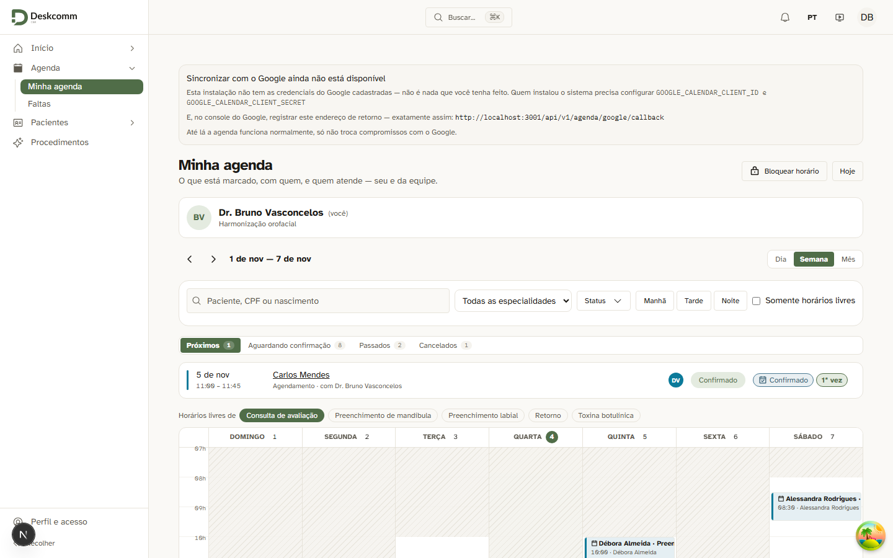
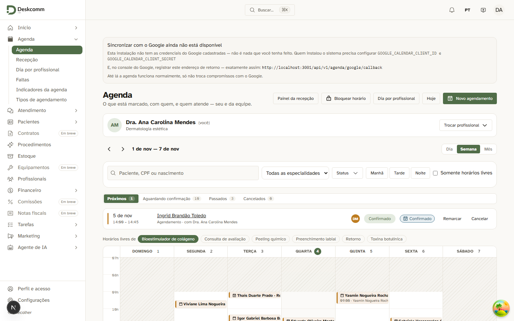
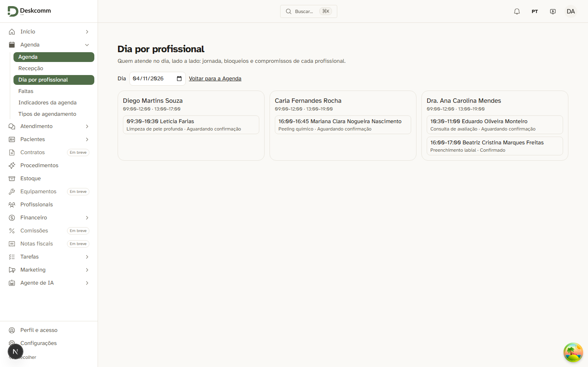
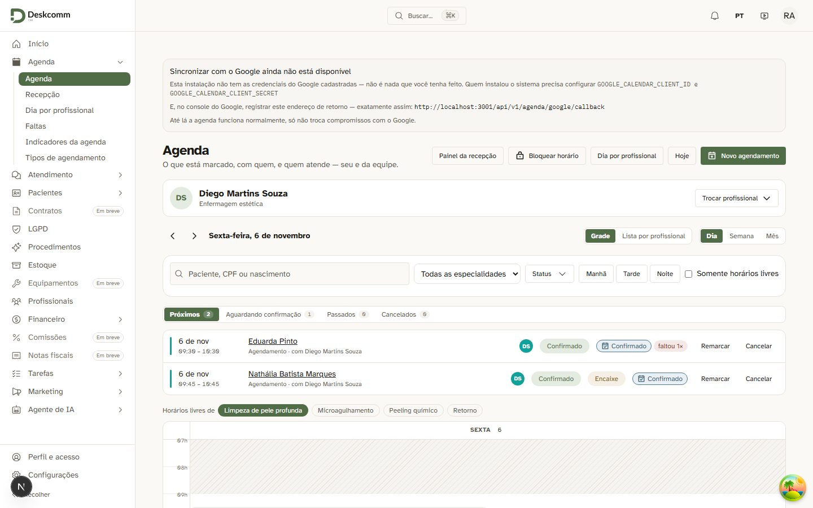
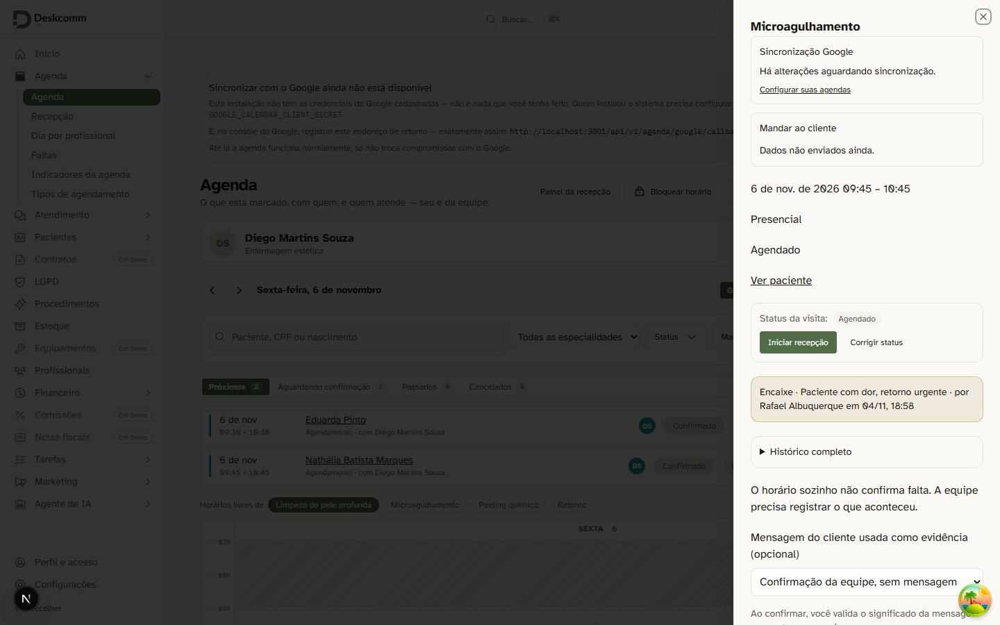
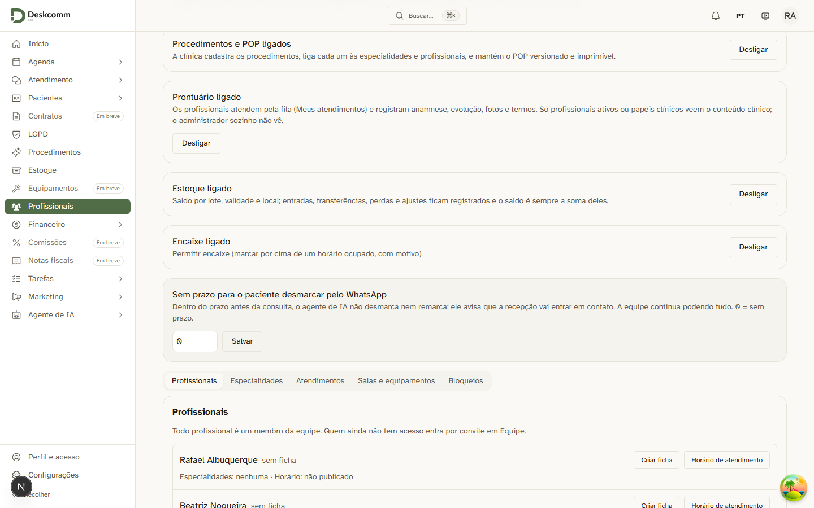

# agenda-s6 — handoff

## S6a — ACL das ações da agenda e porta do dia por profissional (issue #69)

| Critério | Como ficou | Prova |
|---|---|---|
| C13 | `POST/PATCH/DELETE /api/v1/agenda/agendamentos` exigem `agenda.marcar/remarcar/cancelar/registrar_desfecho` (além do papel `agent`); 403 `forbidden_permission` auditado com `details.permissao` | `tests/unit/clinic-guarda-da-agenda.test.ts` (11; sem a guarda, 4 vermelhos) |
| C14 | Lista, detalhe e grade só mostram remarcar/cancelar/confirmar/desfecho com a chave; o profissional não arrasta card | `tests/unit/clinic-agenda-acoes-por-chave.test.tsx`; tela abaixo; `tests/e2e/clinic-agenda-acl.spec.ts` |
| C15 | "Dia por profissional" exige `agenda.ver_outros` no menu, na página (URL direta → `/app/agenda`) e em `GET /api/v1/clinic/dia-por-profissional` (403) | tela + spec |
| C17 | Gerente/administrador seguem com todas as ações e a porta | tela + spec |

Medido na 3001 (2026-11-04, seed de demonstração):

```
BRUNO botões na lista: {"remarcar-":0,"cancelar-":0,"confirmar-":0,"faltou-":0,"realizado-":0}
BRUNO PATCH starts_at → 403 forbidden_permission agenda.remarcar
BRUNO PATCH status=no_show → 403 forbidden_permission agenda.registrar_desfecho
BRUNO DELETE → 403 forbidden_permission agenda.cancelar
BRUNO links 'Dia por profissional' no menu: 0
BRUNO /app/agenda/profissionais → /app/agenda
BRUNO GET dia-por-profissional → 403
ANA botões na lista: {"remarcar-":1,"cancelar-":1}
ANA /app/agenda/profissionais → /app/agenda/profissionais · GET → 200
```

### Evidências de tela

- Dr. Bruno (Profissional de saúde): "Minha agenda" sem Remarcar/Cancelar e sem "Dia por profissional" no menu —
  
- Dra. Ana (gerente): a lista segue com Remarcar/Cancelar —
  
- Dra. Ana abre o "Dia por profissional" —
  

Spec formal (fora do CI, depende do seed): `DEMO_SENHA=… pnpm exec playwright test clinic-agenda-acl` contra a 3001.

### Core tocado
Registrado em `UPSTREAM.md` (linha "Agenda S6a"). Todas as props novas são opcionais e o default é o comportamento do upstream.

### Dívidas
- **S6c:** a ACL fica na rota HTTP; `fn_appointment_change` e escrita direta por PostgREST com sessão ainda não conferem a chave.
- Papel personalizado sem as chaves passa a receber 403 em PATCH/DELETE (os papéis de sistema e o modo legado não perdem).

## S6b — encaixe (issue #69)

| Critério | Como ficou | Prova |
|---|---|---|
| C1 | Opção `settings.clinic.encaixe` nasce desligada; desligada → 422 `encaixe_desligado` | invariant + unit + tela |
| C2 | Com a chave e a opção: `POST … { encaixe: { motivo } }` → 201 `encaixe: true` | tela (abaixo) |
| C3 | Motivo de 5 a 500 caracteres (Zod na rota e CHECK no banco) | unit + invariant |
| C4 | Sem `agenda.encaixe` → 403 `forbidden_permission` (`details.permissao`) | unit + invariant |
| C5 | Horário ocupado com a opção ligada → 409 `agenda_horario_ocupado` listando quem ocupa e `pode_encaixar`; desligada → 422 de antes | unit + tela |
| C6 | Sobre atendimento realizado → 409 `encaixe_sobre_finalizado` | invariant + unit |
| C7 | `clinic_agenda_encaixes` (motivo, ator, sobrepostos) + evento `encaixe` no histórico | invariant |
| C8 | Etiqueta "Encaixe" na lista/grade; motivo e autor no detalhe | tela |
| C9 | Rotas de leitura respeitam o escopo (`agenda.ver_outros`) | rotas `GET /api/v1/clinic/agenda/encaixes` e `…/agendamentos/[id]/encaixe` |
| C10/C12 | Advisory lock mantido; `google_sync` ignorado pela trava | invariant |
| C11 | IA/token → 403 `encaixe_so_pessoa`; a função exige `auth.uid()` | unit (sabotado: 2 vermelhos) |
| C16 | Chave concedida só a Administrador e Gerente; papéis existentes não perdem nada | invariant |

Migrations: **9045** (chave, tabela, histórico, trava, `fn_clinic_agenda_encaixar`) e **9046** (`fn_clinic_definir_encaixe`, a opção). Aplicadas no banco local da 3001 em 2026-11-04.

Medido na 3001 (2026-11-04):

```
A DONO sem encaixe (horário ocupado) → 409 agenda_horario_ocupado {agendamentos:[Eduarda Pinto 09:30–10:30 confirmed], pode_encaixar:true}
  DONO com encaixe às 09:45 → 201 encaixe:true
B DONO encaixe no MESMO início (09:30) → 409 encaixe_mesmo_inicio
C detalhe do encaixe → 200 {motivo:"Paciente com dor, retorno urgente", autor:"Rafael Albuquerque", sobrepostos:[…845]}
D etiquetas "Encaixe" na tela: 2 · E motivo no detalhe: 1
F ANA (papel "Coordenação clínica", sem a chave) → 409 com pode_encaixar:false
G BRUNO com encaixe → 403 forbidden_permission agenda.marcar
```

### Evidências de tela (S6b)

- Lista com a etiqueta "Encaixe" no compromisso das 09:45 —
  
- Detalhe com motivo e autor —
  
- Opção "Permitir encaixe" nas configurações —
  

### Limitações conhecidas
- **Mesmo início:** o índice do núcleo `calendar_appointments_sem_duplicata_idx` impede dois compromissos ativos do mesmo
  profissional começando no mesmo instante; o encaixe precisa começar em outro minuto (409 `encaixe_mesmo_inicio`).
  Liberar exige mudar índice do núcleo — decisão do dono.
- Papéis personalizados (ex.: "Coordenação clínica" do seed) não recebem a chave sozinhos: o dono concede.
- Jornada/bloqueio do encaixe conferidos em `lib/clinic/agenda/encaixe.ts`; aviso mínimo e intervalo da grade não valem no encaixe.
