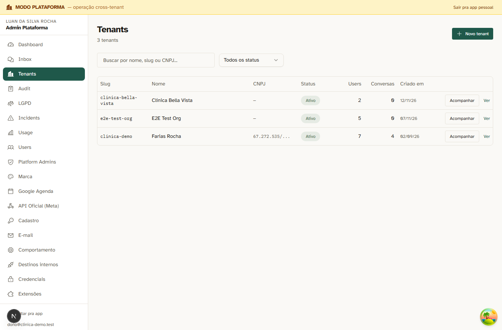
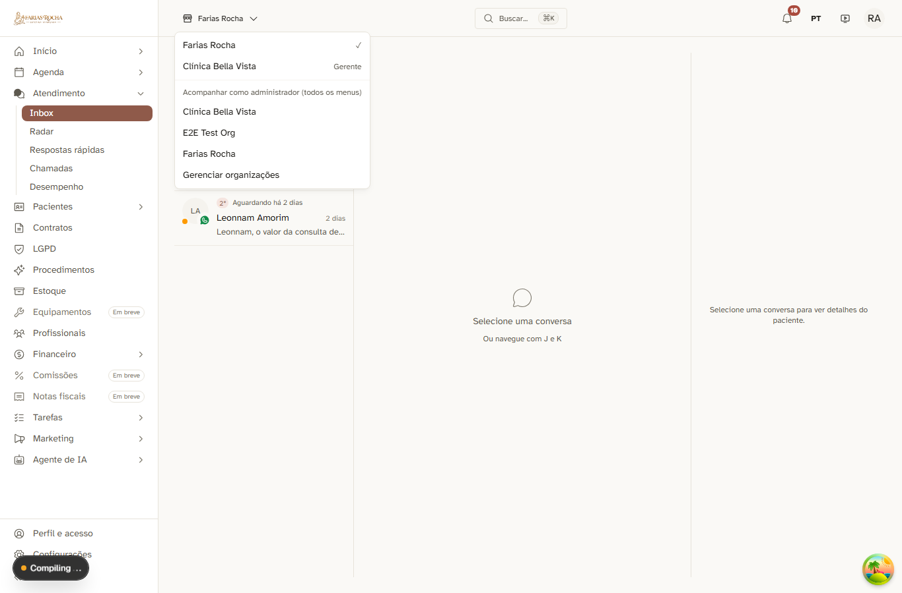
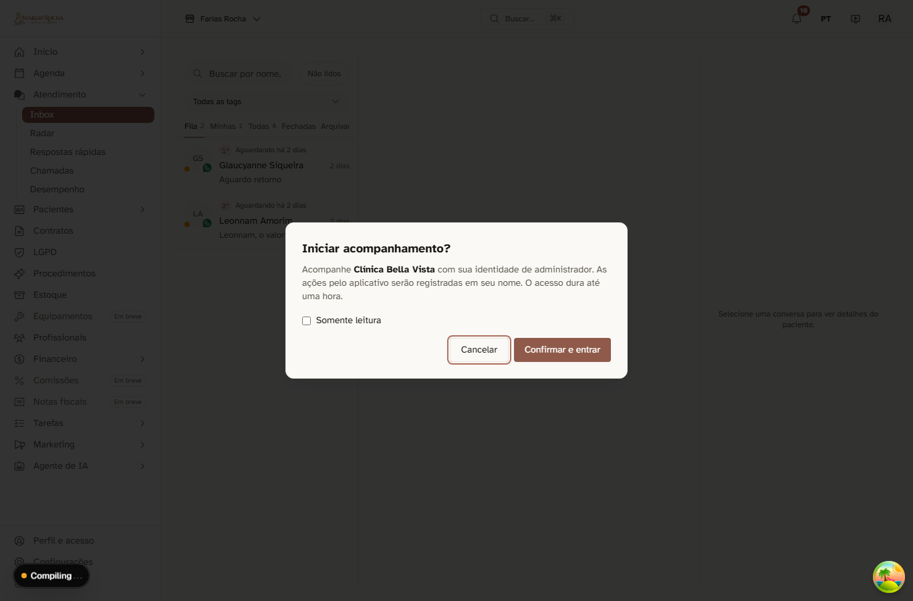
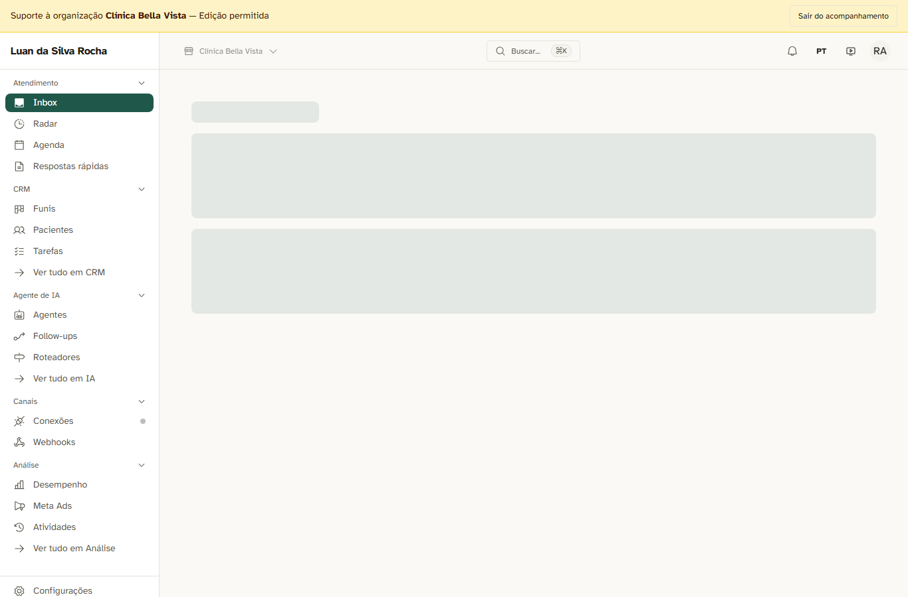

# #155: o botão "Acompanhar" fica visível na lista de tenants e no seletor de empresa

Prova pela tela feita na 3001 (Playwright, 2026-11-12), com a conta do administrador da plataforma (`dono@clinica-demo.test`).

1. **Lista de tenants do `/admin`**: cada linha tem o botão "Acompanhar".
   
2. **Seletor de empresa**: a seção "Acompanhar como administrador (todos os menus)" lista todas as organizações ativas. Onde ele já é membro com cargo menor, o nome do cargo aparece ao lado (na Bella Vista, "Gerente").
   
3. **Confirmação**: é a mesma do acompanhamento da ficha, com a escolha de somente leitura.
   
4. **Dentro da Bella Vista em acompanhamento completo**: aparecem a faixa "Suporte à organização … Edição permitida" e os menus de administrador (Conexões, Webhooks, Configurações), que não aparecem para o cargo de gerente. Os menus de clínica dependem dos módulos ligados (#154).
   

Saída do roteiro:
```
lista: botão Acompanhar visível
seletor: cargo na Bella Vista = Gerente
menus no acompanhamento: Inbox | Radar | Agenda | Respostas rápidas | Funis | Pacientes | Tarefas | Ver tudo em CRM | Agentes | Follow-ups | Roteadores | Ver tudo em IA | Conexões | Webhooks | Desempenho | Meta Ads | Atividades | Ver tudo em Análise
encerrar acompanhamento: 200
```
